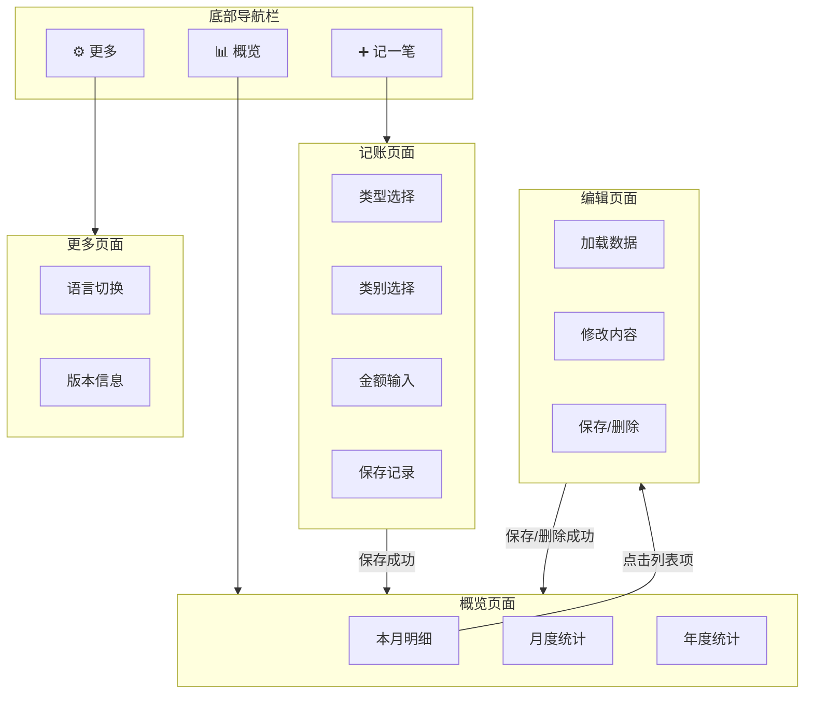

# Vault - 个人记账应用 UX 设计文档

> 🔒 **核心价值：隐私优先** — 完全离线运行，无需网络，数据存储在本地。

---

## 1. 产品概述

这是一款专为个人用户设计的离线记账应用。所有数据存储在设备本地，确保用户的财务隐私不被泄露。

**核心特性：**
- ✅ 100% 离线运行
- ✅ 本地数据存储
- ✅ 快速记账体验
- ✅ 直观的统计图表

---

## 2. 页面导航架构

### 页面交互流程图



---

## 3. 页面结构与交互

### 3.1 底部导航栏 (TabBar)

固定在屏幕底部，包含三个核心入口：

| 入口 | 图标 | 说明 |
|------|------|------|
| **概览** | 📊 柱状图 | 默认页面，查看账单明细和统计图表 |
| **记一笔** | ➕ 圆形按钮 | 突出显示，点击快速进入记账模式 |
| **更多** | ⚙️ 齿轮 | 设置入口 |

---

### 3.2 概览页面 (Overview)

顶部提供三个维度的切换标签：**[ 账本 ]** | **[ 月度 ]** | **[ 年度 ]**

#### a. 账本 Tab (流水模式)
- **核心功能**: 记账流水与当月资产概况。
- **内容**: 
  - Bento Grid 资产卡片 (净资产/收入/支出 + Sparkline)
  - 按日期分组的交易列表 (Sticky 日期头)
  - 筛选控件: `[全部] [支出] [收入]`
- **交互**: 点击列表项进入编辑页面

#### b. 月度/年度 Tab (统计模式)
- **核心功能**: 数据分析与趋势回顾。
- **时间导航**: 顶部显示 `< 2026.01 >` 切换周期, 含 "回到今天" 按钮。
- **布局结构**:
    1.  **汇总卡片 (多行紧凑网格 Bento Grid)**:
        - 结余 / 总收入 (含涨跌幅) / 总支出 (含涨跌幅) / 日均支出 / **预算剩余迷你进度条**
        - 自适应显示：月度视图显示5项，年度视图自适应为4项对齐网格。
    2.  **核心图表**:
        - **[趋势]**: 双折线图 (收入 vs 支出) + 预算虚线 + 底部图例
        - **[结构]**: 堆叠柱状图 (分类占比)
        - **图表细度**: 月度 = 最近12个月, 年度 = 最近5年
        - **交互**: 点击数据点高亮并筛选列表, 左右滑动切换周期
    3.  **分类排行列表**: 
        - 切换 `[支出] / [收入]`
        - 按金额降序的分类卡片 (带进度条)
        - 点击展开查看该分类明细 (手风琴式)

---


### 3.3 记账页面 (Add Entry)

点击底部 **"+"** 按钮进入，采用 **全屏覆盖模式**（无顶部导航栏）。

**页面布局（从上到下）：**

| 序号 | 组件 | 说明 |
|------|------|------|
| 1 | 类型切换 | `收入` / `支出`（默认支出） |
| 2 | 类别网格 | 每行 5 个，共 3-4 行；选中高亮 |
| 3 | 金额显示 | 大字号显示当前输入金额 |
| 4 | 日期/备注 | 日期选择器（默认今天）+ 备注输入框 |
| 5 | 数字键盘 | 左侧运算符（+−×÷）+ 数字 0-9 + 小数点 + 删除键 |
| 6 | 操作按钮 | 底部并列：左侧「取消」+ 右侧「确定」 |

**交互逻辑：**
- ➕ 支持简单四则运算（如输入 `10+5` 显示 `15`）
- ⚠️ 金额为空或 0 时点击确定 → 提示「请输入金额」
- ✅ 保存成功 → 自动跳转回概览页面并提示「记录成功」
- ❌ 点击取消 → 返回上一页

---

### 3.4 编辑页面 (Edit Entry)

- 📐 **复用记账页面的布局和组件**（无顶部导航栏）
-  自动填充该笔账单的现有数据
- 🗑️ 底部增加「删除」按钮（红色警示样式），点击需 **二次确认**

---

### 3.5 更多页面 (Settings)

简洁的配置与管理页面：

| 设置项 | 说明 |
|--------|------|
| **预算设置** | 设置月度预算金额，将在统计图表中显示为警戒线 |
| **类别配置** | 配置支出/收入类别的图标、名称、排序 |
| **提醒通知** | 本地智能记账提醒（每日中午/晚间）与周期花费总结（周报/月报） |
| **数据备份** | 完整数据备份（带版本与防误触快照的 JSON 档案）与安全还原 |
| **数据导出** | 将账单记录导出为 CSV (Excel)，支持预设（上月、去年）及自定义时间范围 |
| **主题/语言** | 切换深色模式/语言 |
| **版本信息** | 显示当前版本号 |

**类别配置功能说明：**
- 支持自定义类别名称和图标
- 可调整类别显示顺序（拖拽排序）
- 可启用/禁用特定类别
- 分别配置支出类别和收入类别

### 3.4.1 本地智能提醒与周期总结规范 (v1.1)
- **100% 离线与隐私优先**：底层采用系统本地计划通知（Local Scheduled Notifications，通过 `expo-notifications`），无任何后端服务，数据不离机。
- **权限与激活策略**：
  - **首次启动引导**：升级/安装 v1.1 后首次启动，展示温和的记账提醒授权弹窗，用户同意后立即申请系统通知权限并激活默认提醒调度。
  - **设置页控制中心**：在设置页提供“智能提醒”独立卡片，包含【每日记账提醒】与【周/月支出总结】独立开关，用户可随时调整或关闭。若系统权限被拒，引导跳转系统设置。
- **每日记账提醒**：
  - 中午提醒（12:30）：“该记午饭啦！记录一笔午间开支吧 🍱”。
  - 晚间提醒（21:30，温和复盘策略）：若当天未记账，提示“今天辛苦啦！复盘一下今天的开销吧 🌙”；若当天已记账，提示“今天已记 %{count} 笔账，看看是否还有遗漏的开销 🌙”。
  - 点击行为：唤醒 App 并直接打开“记一笔”全屏录入弹窗。
- **周期花费总结提醒**：
  - 每周一总结（09:00）：上周一至周日支出总额及最高支出分类明细（如“上周总支出 ¥1,280，其中【餐饮】开销最高。新的一周加油！”）。
  - 每月 1 号总结（09:30）：上月累计支出总额与预算结余（如“上月总支出 ¥5,600，预算结余 ¥1,400。点击查看完整月报”）。
  - 呈现形式：仅保留系统通知栏推送，不额外侵占首页顶部卡片空间。
  - 点击行为：跳转至“统计分析”视图（Overview 统计）。

### 3.4.2 数据全量备份与可恢复/可追溯机制 (v1.1)
- **独立布局**：设置页新增“数据安全与备份”独立卡片，保留原 CSV 导出供外部表格使用，并新增全量 JSON 备份与还原体系。
- **高可追溯性标准 JSON Schema**：备份文件命名规范 `vault_backup_YYYYMMDD_HHmmss.json`，包含：
  - `schemaVersion: 1`: 数据版本号（支持后续版本向后迁移兼容）。
  - `metadata`: 备份生成时间戳、App版本、记录总条数、总收支校验和（Checksum）。
  - `settings`: 货币符号、预算目标、通知配置。
  - `categories`: 自定义分类、排序权重、启用状态。
  - `transactions`: 全量交易流水（UUID/时间/金额/分类/备注）。
- **高稳定性与安全还原**：
  - **还原前安全快照（Safety Auto-Snapshot）**：执行导入还原前，系统自动在本地沙盒持久化一份隐式临时快照 `auto_safety_snapshot.json`。
  - **撤回恢复能力**：导入恢复后，如果用户发现误操作，可点击【撤回上一次导入】，利用安全快照一键回退到导入前的状态。
  - **事务性原子写入**：使用 SQLite 事务包裹清理与重灌，任何格式或写入异常立即回滚，保持数据绝对一致性。
  - **校验预览对话框**：选择备份文件后展示数据摘要（条数、时间、总金额），由用户二次确认后方可执行覆盖导入。

---

## 4. ASCII 原型线框图

### 4.1 概览页面

```
┌─────────────────────────────────────┐
│  ◀  概览                      ···   │
├─────────────────────────────────────┤
│ ┌─────────┬─────────┬─────────┐     │
│ │本月明细 │月度统计 │年度统计 │     │
│ └─────────┴─────────┴─────────┘     │
├─────────────────────────────────────┤
│      [ 收入 ]     [ 支出 ✓]         │
├─────────────────────────────────────┤
│                                     │
│  ┌─────────────────────────────┐    │
│  │ 🍔  食品         01-05      │    │
│  │      早餐                   │-35 │
│  └─────────────────────────────┘    │
│                                     │
│  ┌─────────────────────────────┐    │
│  │ 🚗  交通         01-05      │    │
│  │      地铁                   │-6  │
│  └─────────────────────────────┘    │
│                                     │
│  ┌─────────────────────────────┐    │
│  │ 🛒  购物         01-04      │    │
│  │      日用品                 │-128│
│  └─────────────────────────────┘    │
│                                     │
│            ···更多记录···            │
│                                     │
├─────────────────────────────────────┤
│                                     │
│   ┌───┐       ╭─────╮       ┌───┐   │
│   │ 📊│       │  +  │       │ ⚙️│   │
│   │概览│       ╰─────╯       │更多│   │
│   └───┘                     └───┘   │
│                                     │
└─────────────────────────────────────┘
```

### 4.2 记账页面

```
┌─────────────────────────────────────┐
│                                     │
│       [ 收入 ]     [ 支出 ✓]        │
│                                     │
├─────────────────────────────────────┤
│ ┌─────┬─────┬─────┬─────┬─────┐     │
│ │ 🍔  │ 🚗  │ 🛒  │ 🏠  │ 👔  │     │
│ │食品 │交通 │购物 │居家 │服饰 │     │
│ ├─────┼─────┼─────┼─────┼─────┤     │
│ │ 📱  │ 🍽️  │ 🎮  │ ✈️  │ 🏥  │     │
│ │通讯 │餐饮 │娱乐 │旅游 │医疗 │     │
│ ├─────┼─────┼─────┼─────┼─────┤     │
│ │ 📚  │ 🎁  │ 💄  │ ⚽  │ 🐕  │     │
│ │教育 │礼金 │美容 │运动 │宠物 │     │
│ └─────┴─────┴─────┴─────┴─────┘     │
├─────────────────────────────────────┤
│                                     │
│              ¥ 0.00                 │
│                                     │
├─────────────────────────────────────┤
│   📅 2026-01-05    📝 添加备注...   │
├─────────────────────────────────────┤
│ ┌───┬─────┬─────┬─────┬─────┐       │
│ │ + │  7  │  8  │  9  │  ⌫  │       │
│ ├───┼─────┼─────┼─────┼─────┤       │
│ │ − │  4  │  5  │  6  │     │       │
│ ├───┼─────┼─────┼─────┤     │       │
│ │ × │  1  │  2  │  3  │     │       │
│ ├───┼─────┼─────┼─────┤     │       │
│ │ ÷ │  .  │  0  │     │     │       │
│ └───┴─────┴─────┴─────┴─────┘       │
├─────────────────────────────────────┤
│  ┌──────────────┬──────────────┐    │
│  │     取消     │     确定     │    │
│  └──────────────┴──────────────┘    │
└─────────────────────────────────────┘
```

### 4.3 编辑页面

```
┌─────────────────────────────────────┐
│                                     │
│       [ 收入 ]     [ 支出 ✓]        │
│                                     │
├─────────────────────────────────────┤
│ ┌─────┬─────┬─────┬─────┬─────┐     │
│ │ 🍔  │ 🚗  │ 🛒  │ 🏠  │ 👔  │     │
│ │食品✓│交通 │购物 │居家 │服饰 │     │
│ ├─────┼─────┼─────┼─────┼─────┤     │
│ │ 📱  │ 🍽️  │ 🎮  │ ✈️  │ 🏥  │     │
│ │通讯 │餐饮 │娱乐 │旅游 │医疗 │     │
│ ├─────┼─────┼─────┼─────┼─────┤     │
│ │ 📚  │ 🎁  │ 💄  │ ⚽  │ 🐕  │     │
│ │教育 │礼金 │美容 │运动 │宠物 │     │
│ └─────┴─────┴─────┴─────┴─────┘     │
├─────────────────────────────────────┤
│                                     │
│              ¥ 35.00                │
│                                     │
├─────────────────────────────────────┤
│   📅 2026-01-05    📝 早餐          │
├─────────────────────────────────────┤
│ ┌───┬─────┬─────┬─────┬─────┐       │
│ │ + │  7  │  8  │  9  │  ⌫  │       │
│ ├───┼─────┼─────┼─────┼─────┤       │
│ │ − │  4  │  5  │  6  │     │       │
│ ├───┼─────┼─────┼─────┤     │       │
│ │ × │  1  │  2  │  3  │     │       │
│ ├───┼─────┼─────┼─────┤     │       │
│ │ ÷ │  .  │  0  │     │     │       │
│ └───┴─────┴─────┴─────┴─────┘       │
├─────────────────────────────────────┤
│  ┌────────┬────────┬────────┐       │
│  │ 🗑️删除 │  取消  │  确定  │       │
│  └────────┴────────┴────────┘       │
└─────────────────────────────────────┘
```

### 4.4 更多页面

```
┌─────────────────────────────────────┐
│  ◀  更多                            │
├─────────────────────────────────────┤
│                                     │
│  ┌─────────────────────────────┐    │
│  │  📂  类别配置                │    │
│  │      自定义支出/收入类别 ▶   │    │
│  └─────────────────────────────┘    │
│                                     │
│  ┌─────────────────────────────┐    │
│  │  🌐  语言切换                │    │
│  │      中文 / English     ▶   │    │
│  └─────────────────────────────┘    │
│                                     │
│                                     │
│                                     │
│                                     │
│           Version 1.0.0             │
│                                     │
├─────────────────────────────────────┤
│                                     │
│   ┌───┐       ╭─────╮       ┌───┐   │
│   │ 📊│       │  +  │       │ ⚙️│   │
│   │概览│       ╰─────╯       │更多│   │
│   └───┘                     └───┘   │
│                                     │
└─────────────────────────────────────┘
```

---

## 5. 默认类别配置

### 5.1 支出类别（按使用频率排序）

| 类别码 | 名称 | 英文 | 颜色代码 | 图标建议 |
|--------|------|------|----------|----------|
| `EXP_FOOD` | 食品 | Food | `#F97316` 橙色 | 🍔 hamburger |
| `EXP_TRANSPORT` | 交通 | Transport | `#3B82F6` 蓝色 | 🚗 car |
| `EXP_SHOPPING` | 购物 | Shopping | `#EC4899` 粉色 | 🛒 cart |
| `EXP_HOUSING` | 居家 | Housing | `#8B5CF6` 紫色 | 🏠 house |
| `EXP_CLOTHING` | 服饰 | Clothing | `#06B6D4` 青色 | 👔 shirt |
| `EXP_TELECOM` | 通讯 | Telecom | `#6366F1` 靛蓝 | 📱 phone |
| `EXP_DINING` | 餐饮 | Dining | `#F59E0B` 琥珀 | 🍽️ dining |
| `EXP_ENTERTAINMENT` | 娱乐 | Entertainment | `#EF4444` 红色 | 🎮 game |
| `EXP_TRAVEL` | 旅游 | Travel | `#14B8A6` 青绿 | ✈️ plane |
| `EXP_MEDICAL` | 医疗 | Medical | `#F43F5E` 玫瑰红 | 🏥 hospital |
| `EXP_EDUCATION` | 教育 | Education | `#0EA5E9` 天蓝 | 📚 books |
| `EXP_GIFT` | 礼金 | Gift | `#D946EF` 洋红 | 🎁 gift |
| `EXP_BEAUTY` | 美容 | Beauty | `#E11D48` 玫红 | 💄 lipstick |
| `EXP_SPORTS` | 运动 | Sports | `#22C55E` 绿色 | ⚽ sports |
| `EXP_PET` | 宠物 | Pet | `#A855F7` 紫色 | 🐕 dog |
| `EXP_OTHER` | 其他 | Other | `#6B7280` 灰色 | ❓ other |

### 5.2 收入类别

| 类别码 | 名称 | 英文 | 颜色代码 | 图标建议 |
|--------|------|------|----------|----------|
| `INC_SALARY` | 工资 | Salary | `#10B981` 绿色 | 💰 money |
| `INC_BONUS` | 奖金 | Bonus | `#F59E0B` 琥珀 | 🎉 celebration |
| `INC_INVESTMENT` | 理财 | Investment | `#3B82F6` 蓝色 | 📈 chart |
| `INC_PARTTIME` | 兼职 | Part-time | `#8B5CF6` 紫色 | 💼 briefcase |
| `INC_REFUND` | 退款 | Refund | `#14B8A6` 青绿 | ↩️ refund |
| `INC_OTHER` | 其他 | Other | `#6B7280` 灰色 | ❓ other |

---

## 6. UI/UX 设计规范

### 6.1 设计风格

| 原则 | 说明 |
|------|------|
| **简约现代** | 界面大量留白，视觉降噪，突出核心数据 |
| **卡片式设计** | 内容块使用圆角卡片（`border-radius: 12px`） |
| **色彩语义** | 收入用绿色，支出用红色，主色调蓝色 |

**色彩系统：**

| 用途 | 颜色 | 色值 |
|------|------|------|
| 收入 | 🟢 绿色 | `#10B981` |
| 支出 | 🔴 红色 | `#EF4444` |
| 主色调 | 🔵 蓝色 | `#3B82F6` |

### 6.2 交互体验

| 规范 | 说明 |
|------|------|
| **大触摸区域** | 可点击元素尺寸 ≥ `44×44px`，方便手指操作 |
| **数字体验** | 金额显示使用等宽字体（Monospace），保证数字对齐 |
| **流畅动画** | 页面切换和操作反馈增加 `200-300ms` 平滑过渡 |

---

## 7. 附录

### 更新日志

| 版本 | 日期 | 更新内容 |
|------|------|----------|
| v1.0 | 2026-01-05 | 初始版本，包含完整页面结构和交互定义 |
| v1.1 | 2026-05-17 | 打磨 Android 真机调试细节：适配状态栏防重叠，账本重构为侧向 1:1.4 不对称 Bento Grid 并内建 SVG Sparkline 渐变图，收支趋势图重构为滚动周期并关闭垂直线、净化网格背景 || v1.2 | 2026-06-28 | 优化记账与修改页面布局：压缩底部面板高度（键盘按键高度统一为 44px、精简金额显示与快捷标签），类别网格间距微调，使类别区可完整展示至少 3 行并便于单手操作数字键盘 |
| v1.3 | 2026-06-28 | 优化记一笔关闭转场动效：基于 Reanimated 实现全屏弹窗 260ms 平滑向下滑出关闭（取消/保存/安卓返回键均生效），保存操作改为平滑滑出后异步写入数据库避免掉帧卡顿 |
| v1.1.0-spec | 2026-10-25 | 确立 v1.1 详细需求规格：本地定时智能提醒（每日记账/周月支出总结）与高可用性、可恢复、可追溯的数据全量备份与还原体系 |
